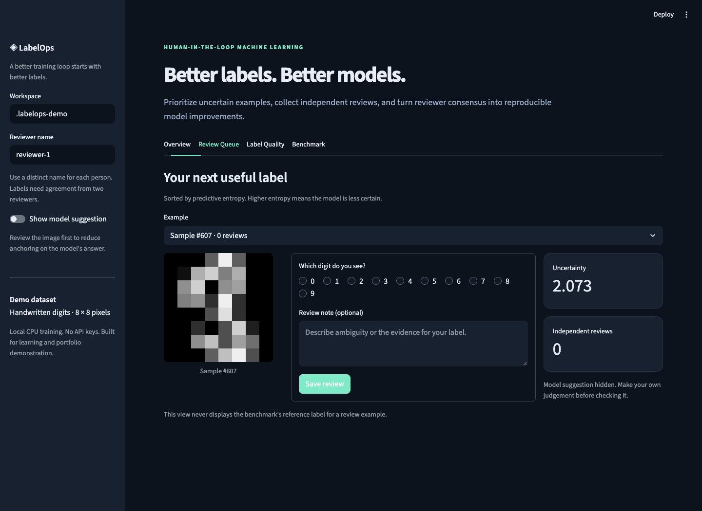
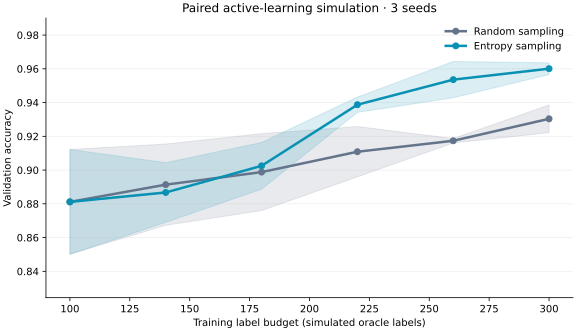

# LabelOps

**A human-in-the-loop ML workbench for choosing what to label, reviewing disagreements, and measuring what the labels change.**

[](https://www.python.org/)
[](LICENSE)
[](https://github.com/rounak251/labelops/actions/workflows/ci.yml)

LabelOps connects a reproducible classification experiment to a working annotation tool. A model ranks examples by uncertainty, reviewers submit labels, consensus becomes training data, and a dashboard reports validation performance and annotation agreement. A FastAPI interface exposes the same workflow for programmatic use.

The project demonstrates practical ML engineering: train-only preprocessing, explicit evaluation boundaries, versioned model provenance, auditable annotation events, tested service interfaces, and a fair active-learning baseline. It runs locally on a CPU, using the small handwritten-digits dataset bundled with scikit-learn.



## What you can explore

| Capability | Engineering question it answers |
| --- | --- |
| Entropy-ranked review queue | Which examples should a reviewer inspect next? |
| Multiple reviewers and majority consensus | When is a label ready to enter training? |
| Append-only annotation history | How did a label change, and who changed it? |
| Explicit retraining and model provenance | Which labels produced the current model? |
| Accuracy, macro F1, probability metrics, and confusion analysis | Where does the model succeed, fail, or show unreliable confidence? |
| Entropy versus random acquisition benchmark | Does the selection rule help at an equal label budget? |
| Streamlit UI, FastAPI service, and CLI | Can one ML workflow support several interfaces? |

## Quickstart

Requires Python 3.10 or newer. The reference environment was tested with Python 3.13 and constrained dependency versions. From a terminal:

```bash
git clone https://github.com/rounak251/labelops.git
cd labelops
python -m venv .venv
source .venv/bin/activate
python -m pip install -e '.[dev]'
labelops benchmark --output reports
streamlit run app.py
```

On Windows, activate the environment with `.venv\Scripts\Activate.ps1` in PowerShell. Open the local URL printed by Streamlit. Dataset loading requires no download; installing the Python dependencies requires an internet connection.

The benchmark writes a [readable report](reports/report.md), [machine-readable results](reports/report.json), and [learning-curve data](reports/learning_curve.csv). The checked-in report is a measured example run; rerun the command to evaluate your environment. The JSON records the environment and experiment configuration.

To replay the tested dependency versions, use Python 3.13 and install with
`python -m pip install -c constraints-tested.txt -e '.[dev]'`. Numerical results
can vary across operating systems and numerical libraries.

## Measured benchmark

At **300 simulated labels**, across seeds **7, 21, and 42**, the fixed strategies produced these final held-out test results:

| Strategy | Test accuracy | Test macro F1 |
| --- | ---: | ---: |
| Random sampling | 93.06% ± 0.99 | 93.15% ± 0.99 |
| Entropy sampling | 95.19% ± 0.47 | 95.19% ± 0.49 |

Values are means ± population standard deviation across the three seed runs, with dispersion expressed in percentage points. The mean paired accuracy difference was **+2.13 percentage points** for entropy sampling. This small experiment does not establish statistical significance, real reviewer time savings, or gains on another dataset.



## Try the review workflow

1. Choose a reviewer name in the app and inspect a queued 8×8 image.
2. Submit the digit label and an optional note.
3. Have a second reviewer inspect the example independently. Two matching votes establish consensus; a tie remains disputed.
4. Use **Label Quality → Revise one of your saved reviews** to correct an earlier vote. Revisions preserve the audit history.
5. Retrain explicitly after consensus labels have accumulated. The model fits the initial seed examples plus the current consensus labels.
6. Inspect validation metrics, class errors, agreement, and model provenance. Export the latest reviewer votes for further analysis; the workspace retains the full event history.

Model suggestions are hidden by default in the UI. Enable **Show model suggestion** in the sidebar after forming your own judgment to inspect its prediction, confidence, and probabilities.

For a one-person demonstration, two clearly named demo reviewers can exercise the consensus mechanism. That is a workflow simulation, not independent human agreement. See the [annotation guide](docs/annotation-guide.md) for rules and examples.

The CLI also supports local training and export:

```bash
labelops train --workspace .labelops
labelops export --workspace .labelops --output annotations.csv
```

## API

Start a local API server with the virtual environment active:

```bash
uvicorn labelops.api:app --host 127.0.0.1 --port 8000
```

Browse the generated API documentation at [http://127.0.0.1:8000/docs](http://127.0.0.1:8000/docs). Reviewer names are local identifiers; the application does not provide user authentication.

| Endpoint | Action |
| --- | --- |
| `GET /health` | Check that the local service is running |
| `GET /summary` | Read validation results, agreement, and model provenance |
| `GET /queue?limit=12` | Get uncertain training examples without oracle labels |
| `GET /annotations` | Inspect the latest reviewer votes |
| `GET /annotations/export` | Download those votes as CSV |
| `POST /annotations` | Submit `{sample_id, reviewer, label, note}` |
| `POST /retrain` | Fit seeds plus current consensus labels |
| `POST /evaluate` | Evaluate the current model on the fixed test set |

The UI and API use `.labelops` by default. Set `LABELOPS_WORKSPACE` to choose another local workspace; the UI also offers a workspace selector. Run one API worker. Separate UI/API processes sharing a workspace read the same annotations but keep independent cached models; a process must retrain or restart to reflect another process's model changes. Use separate workspaces when experimenting independently.

## Experiment design

The benchmark compares **entropy sampling** with **random sampling** using the same initial labels, fixed model, and equal acquisition budgets for each seed. Defaults are three seeds (`7`, `21`, `42`), 100 initial labels, five acquisition rounds, and 40 additional labels per round.

- A stratified 60/20/20 split separates training, validation, and test examples.
- The scaler and logistic-regression model fit only the currently labeled training examples.
- Acquisition selects examples only from the remaining training pool.
- Validation learning curves are recorded at each label budget.
- Each fixed strategy receives one final test evaluation per seed. The test set does not guide acquisition or fitting.

**The benchmark reveals existing dataset labels as an oracle to simulate acquisition.** It measures a selection strategy under clean-label assumptions; it does not measure real annotator effort, annotation quality, or business savings. The live review workflow uses reviewer consensus instead. Entropy sampling is a hypothesis to test, and random sampling may be competitive or better in other settings.

See the [model card](docs/model-card.md) for metric definitions and limitations, and the [architecture](docs/architecture.md) for the data boundaries.

## Verification

```bash
pytest
ruff check .
ruff format --check .
```

The tests cover split isolation, train-only fitting, deterministic selection, annotation revisions and consensus, queue label isolation, persisted annotation membership, model provenance, cache compatibility, API input validation, and benchmark reproducibility. A successful run verifies the implemented contracts; it does not establish production readiness.

## Project map

```text
app.py                    Streamlit review and evaluation interface
src/labelops/
  data.py                 Dataset splits and stable sample IDs
  model.py                Training pipeline and entropy ranking
  metrics.py              Classification and probability diagnostics
  store.py                Annotation events, consensus, and agreement
  service.py              Workbench orchestration and model provenance
  benchmark.py            Controlled acquisition experiment and reports
  cli.py                  Benchmark, train, and export commands
  api.py                  FastAPI application
tests/                    Behavioral and isolation tests
reports/                  Reproducible benchmark artifacts
docs/                     Architecture, model card, and interview guide
```

## Scope and next steps

The bundled dataset contains 1,797 low-resolution digit images. It is an educational benchmark, and this project does not establish performance on new writers, scanned documents, or production annotation queues. It uses classical supervised learning; there is no LLM, paid API, or cloud deployment.

Useful extensions include a new dataset adapter with group-aware splits, adjudication for disputed examples, authentication, a shared model-state coordinator, and an experiment that measures actual reviewer time. These are extension ideas, not shipped capabilities.

For presenting the project in applications, use the [interview guide](docs/interview-guide.md): it includes a short demo script, technical discussion prompts, and resume bullet templates tied to verifiable work.

## Dataset credit and license

The demo loads [`sklearn.datasets.load_digits`](https://scikit-learn.org/stable/modules/generated/sklearn.datasets.load_digits.html), which packages the 1,797-example test portion of the UCI handwritten-digits dataset. LabelOps creates its own splits within that bundled portion; its test set is not the original UCI benchmark split.

Dataset credit: E. Alpaydin and C. Kaynak, *Optical Recognition of Handwritten Digits* (1998), [UCI Machine Learning Repository](https://archive.ics.uci.edu/dataset/80/optical+recognition+of+handwritten+digits), [DOI: 10.24432/C50P49](https://doi.org/10.24432/C50P49). UCI lists the dataset under [CC BY 4.0](https://creativecommons.org/licenses/by/4.0/).

Project code is released under the [MIT license](LICENSE). Third-party datasets and dependencies retain their own licenses.
