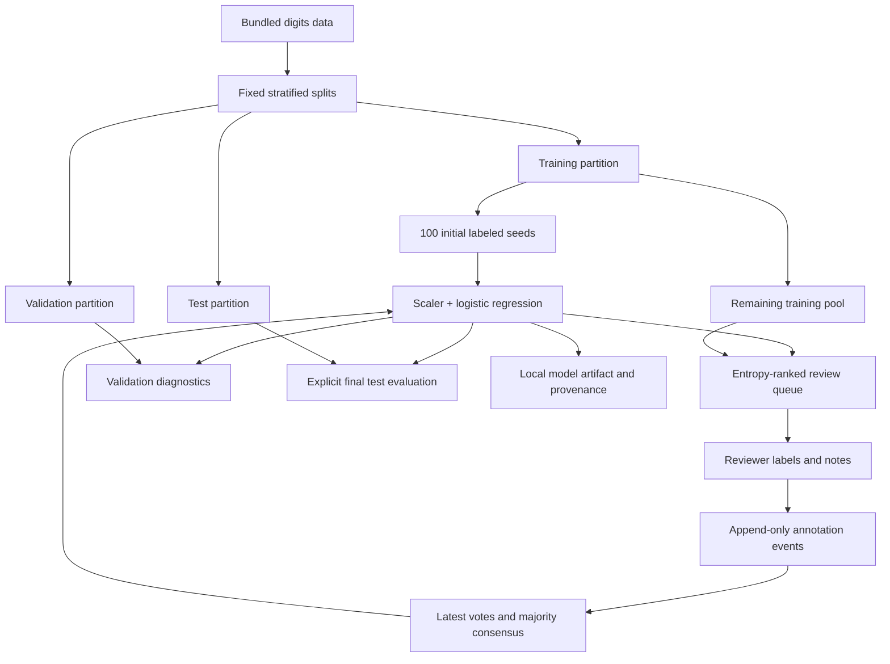
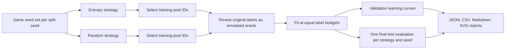

# Architecture

LabelOps puts a small supervised-learning pipeline behind a shared workbench service. The UI, API, and CLI use the same annotation and retraining rules. The offline acquisition benchmark is a separate experiment so simulated oracle labels do not become live-review labels.

## Data flow

The training pool provides images and sample IDs to the queue. Queue responses include predictions, confidence, entropy, probability vectors, and review status, but exclude original pool labels. The UI hides model suggestions by default until the reviewer enables the sidebar toggle. Validation and test labels are evaluation inputs only.

## Components

| Module | Responsibility |
| --- | --- |
| `data.py` | Load the bundled dataset, create seeded splits, select initial labels, and identify the dataset |
| `model.py` | Fit a scaler/classifier pipeline on supplied rows and rank probabilities by entropy |
| `metrics.py` | Compute aggregate, per-class, confusion, and probability diagnostics |
| `store.py` | Validate annotations, preserve event history, derive current votes and consensus, and export data |
| `service.py` | Enforce sample membership, orchestrate the queue and retraining, and track model provenance |
| `benchmark.py` | Compare fixed acquisition strategies under equal budgets and produce artifacts |
| `cli.py` | Expose local benchmark, training, and export commands |
| `api.py` | Validate HTTP requests and expose the workbench through FastAPI |
| `app.py` | Present review, agreement, training, and evaluation actions through Streamlit |

The service is the boundary for dataset membership. A well-formed digit label alone is insufficient: the sample must belong to the training pool. This prevents UI or API callers from turning validation or test examples into fitting data. The service also checks prepopulated annotation rows at startup and before fitting, so lower-level store writes cannot bypass the training-pool boundary.

## Annotation state

Each submitted annotation is a row in the SQLite `annotation_events` table, with an event ID, sample ID, reviewer identifier, label, note, and creation time. Revisions append a new event. The current-vote view takes the greatest event ID for each `(sample_id, reviewer)` pair, while the event history preserves earlier votes. CSV export contains the latest votes, not every historical event.

Consensus requires at least two reviewer identifiers and one label receiving more than half of the current votes. A tie has no consensus. Agreement summaries include counts and pairwise Cohen's kappa where reviewers overlap. Kappa describes observed agreement beyond a chance baseline; it does not certify label correctness.

Queue entries exclude seed and current-consensus examples. Saving a vote changes annotation state immediately; it does not silently refit the model. An explicit retrain operation fits the seeds plus current consensus and records the labels used. A later vote revision can therefore leave the current model trained on an earlier consensus until another retrain. The provenance and pending changes make that boundary inspectable. The UI provides a revision form under **Label Quality → Revise one of your saved reviews**.

## Model lifecycle

1. Load the fixed dataset and validate the annotation workspace.
2. Fit the initial model, or restore a compatible persisted model and provenance.
3. Rank the remaining training pool with the current model.
4. Collect votes and calculate current consensus.
5. On retrain, validate persisted rows and build the fitting set from seed and consensus labels only.
6. Persist the fitted pipeline and its provenance; report validation diagnostics.
7. Evaluate the fixed test split only when explicitly requested.

The scaler is inside the pipeline, so its statistics are fitted on the same labeled rows as the classifier. Loading the entire unlabeled pool to calculate scaling parameters would change that contract and is excluded.

Saved model bundles include the exact model configuration and versions of Python, NumPy, SciPy, scikit-learn, joblib, and threadpoolctl. Cache reuse checks this metadata together with the dataset fingerprint, fitting provenance, and estimator parameters. Incompatibility triggers a refit; it does not silently reuse a model trained under a different configuration.

## Offline benchmark boundary

There is no search for the best test score. Acquisition configuration and model workload are fixed before each run. Split seeds and sample IDs make the comparison reproducible and reviewable. Numerical details may still vary across dependency versions or numerical libraries; record the environment when comparing runs. The reference environment was tested with Python 3.13 and constrained dependencies.

## Local operation

The default workspace is `.labelops`, containing `annotations.sqlite3` and `model.joblib`. The model file is an atomically replaced bundle of the pipeline, schema version, dataset fingerprint, configuration, dependency versions, and provenance. Provenance includes the fitting IDs, seed IDs, consensus labels, label hash, training count, fit time, and model version. Only load trusted local model artifacts.

Set `LABELOPS_WORKSPACE` to override the default workspace; the UI also provides a workspace selector. Keep workspace files outside source control. Use a separate workspace for a new review session or a new dataset; do not reuse incompatible artifacts.

The shipped application is intended for a trusted local machine. Reviewer names identify votes but do not authenticate a person. Run one API worker. UI and API processes sharing a workspace read shared annotations but retain independent in-memory fitted models; retrain or restart the affected process after another process changes the model. Synchronized shared model state is outside the current local design.

A shared deployment would need authentication, authorization, coordinated model state, request limits, monitoring, and a deliberate retention policy. The current design keeps those extensions explicit rather than claiming they are present.

## Testable invariants

- Training, validation, and test IDs are disjoint.
- The seed set is a subset of training, and the pool excludes those seeds.
- Fitted preprocessing uses the current fitting rows only.
- Acquisition never selects validation or test IDs.
- Queue responses do not include oracle labels.
- Persisted annotations outside the training pool are rejected before fitting.
- Reviewer revisions preserve prior events and update the current-vote view.
- Consensus follows the minimum-reviewer and strict-majority policy.
- Model provenance matches the fitting labels and survives a workspace restart.
- Saved models from incompatible configurations or dependency versions are not silently reused.
- Fixed benchmark configuration yields reproducible selection and result artifacts within the recorded environment.
